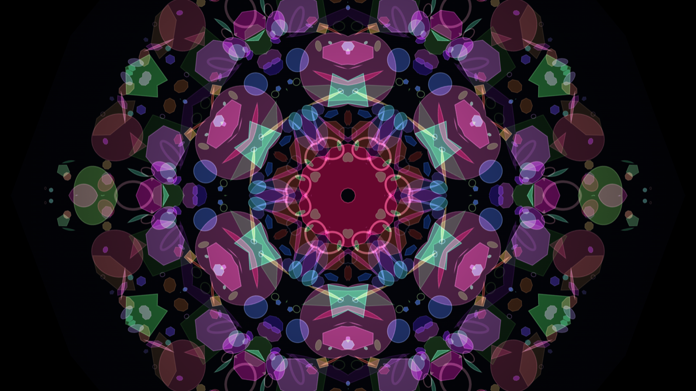

# Kaleidoscope

A six-fold kaleidoscope in a single dependency-free HTML file.

**[Open it →](https://raggedr.github.io/kaleidescope/)**



## The geometry

Two mirrors meeting at an angle α generate a dihedral group of order 2π/α. "Six-fold"
means D₆, of order 12 — so the fundamental domain is a **30°** wedge, not 60°. (A 60°
wedge gives D₃, order 6, which has only three-fold rotational symmetry. This is the
usual off-by-a-factor-of-two.)

The render loop is that group, written out directly:

```js
for (let k = 0; k < 6; k++)        // six rotations
  for (const m of [1, -1])         // each with both chiralities
    drawWedge(k * 60°, m);
```

Seams never need computing. Every wedge draws the *same* source through a different
group element, so reflection across a shared mirror line is an involution and adjacent
edges agree exactly. The only artifact is sub-pixel antialiasing at the clip boundary,
absorbed by widening each wedge by ε = 0.0022 rad.

## The fragment

An offscreen 2048² "object chamber" holds ~880 translucent glass chips — polygons,
discs, rings and slivers on a power-law size distribution, in a harmonised palette —
composited with `lighter` so overlaps glow like stacked stained glass. They drift and
bounce off a circular wall, as chips do in a real tube.

Two motions are distinct, and confusing them is the main design trap:

- **`spin`** rotates the mirrors, turning the finished rosette rigidly. Nothing new
  enters it.
- **Translating the sample point** slides fresh chips *through* the fundamental domain.
  Because every wedge reflects that slice, a small linear translation becomes a large
  rotational churn in the output. This is what makes the pattern evolve, and it runs on
  a two-frequency orbit (236 px at ~45 s, plus 152 px at 0.37× that rate) so it never
  settles into a short period.

The chamber repaints at 30 Hz while the view renders at 60 Hz — the motion you perceive
comes from the transform, not the chip drift, so the lower content rate is invisible.

## Seeds

A fragment is fully determined by one 24-bit seed driving a `mulberry32` PRNG: position,
size, hue and kind of every chip read from that stream. The seed is shown on the button
and written to `location.hash`, so the URL is a permalink to a specific kaleidoscope —
no storage, no serialisation format. Chip *motion* is not reseeded, so a seed reopens
the same tube rather than freezing a frame.

## Controls

| | |
|---|---|
| **New fragment** | a new seed |
| drag | tilt the tube |
| scroll | zoom |
| `space` | pause |
| `N` | new seed |
| drop an image | use it as the fragment instead of the glass chips |

## Running it

Open `index.html`. There is no build step and no dependency.

## Licence

MIT © Robin Langer
